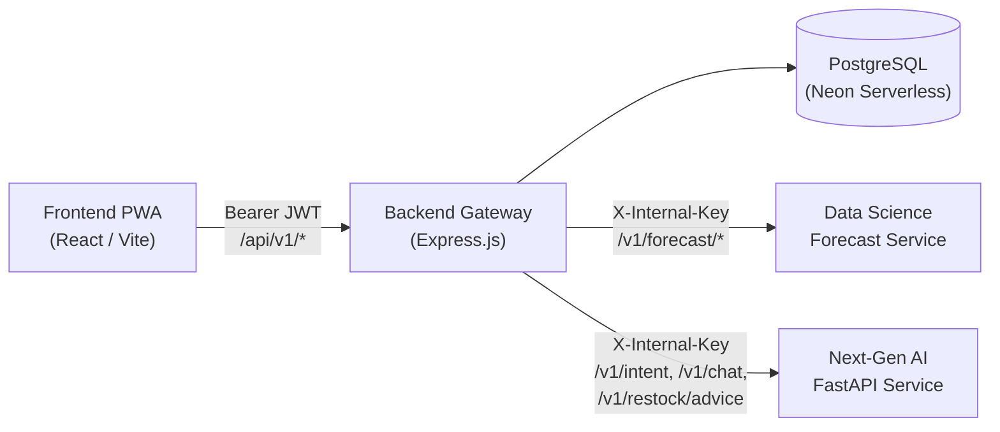

# API Contract & Integration Schema v1.0 — Matchamind × Hidji Coffee & Matcha

Dokumen ini merupakan **kontrak resmi pertukaran data (JSON Request/Response, Endpoint, Kode Error, dan Aturan Fallback)** antara 3 jalur pengembangan:
- **Frontend PWA** (Melsindy & Wasima — React/Vite)
- **Backend Gateway** (Ilyas — Node.js/Express + PostgreSQL Neon Serverless)
- **Data Science** (Alwi & Lulu — Forecasting Kebutuhan Bahan)
- **Next-Gen AI Service** (Yudistira — FastAPI NLP Intent Classifier + Gemini Advisor + Local Fallback)

---

## 0. Arsitektur Komunikasi & Aturan Global



### Aturan Wajib:
1. **Frontend dilarang memanggil `ai-service` atau `data-science` secara langsung.** Seluruh permintaan wajib melewati Backend Express agar API key (`GEMINI_API_KEY`, `INTERNAL_API_KEY`) dan URL microservice tetap aman di server.
2. **Idempotency untuk Offline PWA:** Request mutasi stok (`POST /api/v1/sales` dan `POST /api/v1/stock/closing`) menyertakan `client_request_id` (UUID) agar sinkronisasi ulang saat internet kampus tidak stabil tidak menimbulkan pencatatan ganda.
3. **Zero-Hallucination Angka:** Kuantitas restok (`recommended_qty`) dihitung secara **deterministik** oleh kode server/AI service. LLM hanya merangkai narasi teks dan draf pesan WhatsApp.
4. **Penamaan ID Bahan & Menu:** Mengacu pada `v4_Hidji_Data_Dictionary_Draft.xlsx`:
   - Bahan Baku (`BAR01`–`BAR19` termasuk `BAR14` Cup Reguler & `BAR19` Cup Large, `KOP01`–`KOP23`, `MAT01`–`MAT06`, `TMB01` Es krim vanilla, `TMB02` Bahan teh).
   - Menu (`M01`–`M24`) dengan varian ukuran `R` (Reguler) dan `L` (Large, rasio konsumsi ±1.3x).
5. **Format Standar Error (Semua Layanan):**
   ```json
   {
     "status": "error",
     "error": {
       "code": "VALIDATION_ERROR",
       "message": "Pesan ramah pengguna yang jelas",
       "details": []
     }
   }
   ```

### Standar Kode Status HTTP:
| HTTP Code | Error Code | Makna & Penanganan |
| :---: | :--- | :--- |
| `200` / `201` | — | Berhasil (termasuk saat fallback AI aktif dengan `"fallback_used": true`). |
| `400` | `BAD_REQUEST` | Format JSON rusak atau parameter wajib tidak lengkap. |
| `401` | `UNAUTHORIZED` | Token JWT / `X-Internal-Key` tidak ada atau kedaluwarsa. |
| `403` | `FORBIDDEN` | Hak akses ditolak (misal akun `barista` mencoba mengakses endpoint khusus `gm`). |
| `404` | `NOT_FOUND` | ID bahan/menu/supplier tidak ditemukan di database. |
| `422` | `VALIDATION_ERROR` | Nilai tidak valid (misal stok negatif `-5`, teks kosong, atau bukan angka). |
| `429` | `AI_QUOTA_EXCEEDED` | Batas kuota Gemini API tercapai (AI service otomatis fallback ke template lokal). |
| `503` | `AI_SERVICE_UNAVAILABLE` | Microservice AI/DS tidak dapat dihubungi; Backend mengembalikan data stok mentah + flag fallback agar aplikasi tetap bisa dipakai. |
| `504` | `UPSTREAM_TIMEOUT` | Layanan AI melebihi batas tunggu (timeout Backend ke AI disarankan **10 detik**). |

---

## 1. Backend Express $\leftrightarrow$ Next-Gen AI Service (`ai-service` FastAPI)

* **Base URL Lokal:** `http://localhost:8000`
* **Swagger UI Interaktif:** `GET /docs`
* **Header Wajib (selain `/health`):**
  * `Content-Type: application/json`
  * `X-Internal-Key: <AI_SERVICE_INTERNAL_KEY>`

---

### 1.1. Health Check
* **Endpoint:** `GET /health`
* **Tujuan:** Memeriksa status hidup service, model NLP lokal yang dimuat, dan kesiapan Gemini API.
* **Response (`200 OK`):**
```json
{
  "status": "ok",
  "model_loaded": true,
  "model_version": "tfidf-logreg-v1.0",
  "llm_available": true,
  "llm_model": "gemini-2.5-flash"
}
```

---

### 1.2. Klasifikasi Intent NLP Mandiri (Main Quest)
* **Endpoint:** `POST /v1/intent`
* **Tujuan:** Mengklasifikasikan maksud kalimat/perintah staf atau GM ke salah satu dari **6 kelas intent**:
  `cek_stok` | `minta_rekomendasi` | `buat_draf_pesanan` | `tanya_resep_sop` | `lapor_kendala_stok` | `di_luar_konteks`.
* **Request Payload:**
```json
{
  "text": "susu uht sama sirup karamel sisa brp ya?",
  "top_k": 3
}
```
* **Response (`200 OK`):**
```json
{
  "status": "success",
  "intent": "cek_stok",
  "confidence": 0.94,
  "needs_clarification": false,
  "normalized_text": "susu uht sama sirup karamel sisa berapa ya",
  "entities": ["KOP03", "KOP15"],
  "top_k": [
    { "intent": "cek_stok", "confidence": 0.94 },
    { "intent": "minta_rekomendasi", "confidence": 0.04 },
    { "intent": "tanya_resep_sop", "confidence": 0.01 }
  ],
  "model_version": "tfidf-logreg-v1.0",
  "latency_ms": 4.2
}
```
* **Catatan Ambang Kepercayaan:** Jika `confidence < 0.60`, maka `"needs_clarification": true` dan UI/chat meminta pengguna memperjelas pertanyaannya.

---

### 1.3. Rekomendasi Restock & Draf Pesan WhatsApp (Halaman GM · Restock)
* **Endpoint:** `POST /v1/restock/advice`
* **Tujuan:** Menghitung kuantitas restok secara deterministik, memetakan dampak menu, menyusun ringkasan daftar belanja, dan menghasilkan draf pesan WhatsApp per supplier.
* **Request Payload:**
```json
{
  "date": "2026-11-23",
  "items": [
    {
      "id": "KOP03",
      "name": "Susu UHT",
      "unit": "liter",
      "current_stock": 1.5,
      "minimum_stock": 3.0,
      "forecast_next_day": 4.5,
      "lead_time_days": 1,
      "pack_size": 1,
      "supplier_id": "SUPP-01",
      "supplier_name": "Supplier Susu Diamond",
      "supplier_phone": "6281234567890"
    },
    {
      "id": "KOP15",
      "name": "Sirup Karamel",
      "unit": "botol",
      "current_stock": 0.125,
      "minimum_stock": 0.5,
      "forecast_next_day": 0.25,
      "lead_time_days": 1,
      "pack_size": 1,
      "supplier_id": "SUPP-02",
      "supplier_name": "Supplier Bahan Kopi Jogja",
      "supplier_phone": "6281987654321"
    }
  ]
}
```
* **Response (`200 OK` — Mode Normal Gemini API):**
```json
{
  "status": "success",
  "summary": "Terdapat 2 bahan di bawah batas minimum: Susu UHT (sisa 1,5 liter) dan Sirup Karamel (sisa 0,125 botol). Prioritaskan pemesanan sebelum operasional besok pagi.",
  "items": [
    {
      "id": "KOP03",
      "name": "Susu UHT",
      "stock_status": "menipis",
      "recommended_qty": 6,
      "unit": "liter",
      "affected_menus": ["Cafe Latte Ice", "Matcha Latte", "Aren Latte"],
      "reason": "Sisa 1,5 liter di bawah batas minimum 3 liter dengan proyeksi pemakaian besok 4,5 liter."
    },
    {
      "id": "KOP15",
      "name": "Sirup Karamel",
      "stock_status": "menipis",
      "recommended_qty": 1,
      "unit": "botol",
      "affected_menus": ["Caramel Macchiato", "Flavour Latte"],
      "reason": "Sisa 0,125 botol di bawah batas minimum 0,5 botol."
    }
  ],
  "drafts": [
    {
      "supplier_id": "SUPP-01",
      "supplier_name": "Supplier Susu Diamond",
      "message": "Halo Supplier Susu Diamond, kami dari Hidji Coffee & Matcha (Farmasi UGM) ingin memesan Susu UHT sebanyak 6 liter untuk pengiriman besok pagi. Mohon konfirmasi ketersediaan stoknya. Terima kasih!",
      "wa_link": "https://wa.me/6281234567890?text=Halo%20Supplier%20Susu%20Diamond%2C..."
    },
    {
      "supplier_id": "SUPP-02",
      "supplier_name": "Supplier Bahan Kopi Jogja",
      "message": "Halo Supplier Bahan Kopi Jogja, kami dari Hidji Coffee & Matcha (Farmasi UGM) ingin memesan Sirup Karamel sebanyak 1 botol untuk pengiriman besok pagi. Mohon konfirmasi ketersediaan stoknya. Terima kasih!",
      "wa_link": "https://wa.me/6281987654321?text=Halo%20Supplier%20Bahan%20Kopi%20Jogja%2C..."
    }
  ],
  "fallback_used": false,
  "fallback_reason": null,
  "model_version": "gemini-2.5-flash"
}
```
* **Perilaku Fallback (`200 OK` saat Kuota Gemini Habis / Timeout / Angka Tidak Cocok):**
  * Struktur JSON **identik**, tetapi `"fallback_used": true`, `"fallback_reason": "llm_quota_exceeded"` (atau `"llm_timeout"` / `"numeric_guardrail_triggered"`), `"model_version": "local-template-v1.0"`, dan teks `summary` serta `drafts[].message` disusun otomatis oleh *local deterministic template drafter*.

---

### 1.4. Asisten Chat Interaktif + RAG (Halaman GM · Dasbor)
* **Endpoint:** `POST /v1/chat`
* **Tujuan:** Menjalankan pipeline penuh: *Intent Classifier* $\rightarrow$ *Router* (Cek Stok / Rekomendasi / RAG Resep & SOP / Draf WA / Penolakan Luar Konteks).
* **Request Payload:**
```json
{
  "text": "kalau sirup karamel habis, menu apa yang kena?",
  "stock_snapshot": [
    { "id": "KOP15", "name": "Sirup Karamel", "current_stock": 0.125, "minimum_stock": 0.5, "unit": "botol", "status": "menipis" }
  ],
  "forecast": [
    { "id": "KOP15", "forecast_next_day": 0.25, "unit": "botol" }
  ]
}
```
* **Response (`200 OK` — Dalam Konteks):**
```json
{
  "status": "success",
  "intent": "tanya_resep_sop",
  "confidence": 0.94,
  "answer": "Sirup Karamel dipakai di 2 menu: Caramel Macchiato (M05) dan Flavour Latte varian caramel (M07). Sisa stok saat ini 0,125 botol (di bawah batas minimum 0,5 botol).",
  "sources": ["Master_Bahan:KOP15", "Menu:M05", "Menu:M07"],
  "actions": [
    { "type": "navigate", "target": "/restock", "label": "Buka Menu Restock" }
  ],
  "fallback_used": false,
  "model_version": "tfidf-logreg-v1.0"
}
```
* **Response (`200 OK` — Pertanyaan di Luar Konteks / Guardrail):**
```json
{
  "status": "success",
  "intent": "di_luar_konteks",
  "confidence": 0.98,
  "answer": "Maaf, saya hanya dapat membantu informasi stok bahan baku, resep menu, dan penyusunan draf pesanan supplier untuk Hidji Coffee & Matcha.",
  "sources": [],
  "actions": [],
  "fallback_used": false,
  "model_version": "tfidf-logreg-v1.0"
}
```

---

## 2. Backend Express $\leftrightarrow$ Data Science Forecast (`data-science`)

* **Endpoint:** `POST /v1/forecast/daily` *(dapat dijalankan sebagai service Python terpisah atau digabung dalam modul Python bersama `ai-service`)*
* **Request Payload:**
```json
{
  "target_date": "2026-11-24",
  "materials": [
    {
      "material_id": "KOP03",
      "unit": "liter",
      "history": [
        { "date": "2026-11-18", "used_qty": 4.0 },
        { "date": "2026-11-19", "used_qty": 4.5 },
        { "date": "2026-11-20", "used_qty": 5.0 },
        { "date": "2026-11-21", "used_qty": 4.2 },
        { "date": "2026-11-23", "used_qty": 4.6 }
      ]
    }
  ]
}
```
* **Response (`200 OK`):**
```json
{
  "status": "success",
  "target_date": "2026-11-24",
  "model_version": "ridge-regression-v1.0",
  "predictions": [
    {
      "material_id": "KOP03",
      "forecast_next_day": 4.5,
      "unit": "liter",
      "baseline_ma7": 4.46
    }
  ]
}
```

---

## 3. Frontend PWA $\leftrightarrow$ Backend Express (`/api/v1/...`)

Seluruh endpoint selain `/api/v1/auth/login` wajib menyertakan header:
`Authorization: Bearer <jwt-token>`

| Modul | Method & Endpoint | Role | Fungsi Utama |
| :--- | :--- | :---: | :--- |
| **Auth** | `POST /api/v1/auth/login` | Publik | Login username & password $\rightarrow$ mengembalikan JWT & `role` (`barista` \| `gm`). |
| **Master** | `GET /api/v1/materials` | Barista, GM | Daftar master bahan, sisa stok, minimum stok, satuan baku, dan status (`aman`/`menipis`/`habis`). |
| **Master** | `POST /api/v1/materials`<br>`PATCH /api/v1/materials/:id` | GM | Tambah/ubah master bahan, batas minimum, isi per kemasan, dan supplier. |
| **Menu & BOM** | `GET /api/v1/menus` | Barista, GM | Daftar menu & status kesiapan resep BOM (untuk layar `Catat Penjualan`). |
| **Penjualan** | `POST /api/v1/sales` | Barista, GM | Konfirmasi keranjang penjualan $\rightarrow$ pemotongan stok otomatis sesuai BOM. |
| **Closing** | `POST /api/v1/stock/closing` | Barista, GM | Simpan sisa fisik bahan saat closing (`< 2 menit`), hitung selisih, & simpan log mutasi. |
| **Mutasi** | `GET /api/v1/stock/mutations` | GM | Riwayat perubahan stok (masuk, pemakaian penjualan, koreksi closing). |
| **Dasbor** | `GET /api/v1/dashboard/summary` | GM | KPI (`aman`, `menipis`, `habis`), grafik proyeksi DS, dan daftar bahan kritis. |
| **Restock AI** | `GET /api/v1/restock/recommendations` | GM | Proxy ke `POST /v1/restock/advice` + simpan riwayat ke tabel `inference_logs`. |
| **Chat AI** | `POST /api/v1/assistant/chat` | GM | Proxy ke `POST /v1/chat` (melampirkan `stock_snapshot` terbaru) + simpan ke `inference_logs`. |

### Detail Payload Endpoint Kunci Frontend $\leftrightarrow$ Backend:

#### Login — `POST /api/v1/auth/login`

Request JSON:

```json
{
  "username": "barista-demo",
  "password": "<password akun>"
}
```

Respons `200 OK`:

```json
{
  "token": "<jwt-token>",
  "role": "barista"
}
```

Token berlaku satu jam. Nilai `role` adalah `barista` atau `gm`.
Login memakai format error standar. Field wajib yang hilang menghasilkan
`400 BAD_REQUEST`, nilai yang tidak valid menghasilkan `422 VALIDATION_ERROR`,
dan kredensial yang salah menghasilkan `401 UNAUTHORIZED`. Pembatasan
percobaan login di Express memakai `429 RATE_LIMIT_EXCEEDED`.

#### A. `POST /api/v1/sales` (Barista — Catat Penjualan)
```json
{
  "client_request_id": "550e8400-e29b-41d4-a716-446655440001",
  "sold_at": "2026-11-23T14:30:00+07:00",
  "items": [
    { "menu_id": "M02", "variant": "R", "qty": 2 },
    { "menu_id": "M16", "variant": "L", "qty": 1 }
  ]
}
```

#### B. `POST /api/v1/stock/closing` (Barista — Closing Stok)
```json
{
  "client_request_id": "550e8400-e29b-41d4-a716-446655440002",
  "closing_date": "2026-11-23",
  "notes": "Operasional lancar, tidak ada bahan tumpah",
  "entries": [
    { "material_id": "KOP03", "remaining_stock": 1.5 },
    { "material_id": "KOP01", "remaining_stock": 350 },
    { "material_id": "MAT01", "remaining_stock": 120 },
    { "material_id": "KOP15", "remaining_stock": 0.125 },
    { "material_id": "BAR15", "remaining_stock": 24 }
  ]
}
```

#### C. `POST /api/v1/assistant/chat` (GM — Panel Asisten Stok Hidji)
```json
{
  "text": "kalau sirup karamel habis, menu apa yang kena?"
}
```

---

## 4. Rekomendasi Tabel `inference_logs` di PostgreSQL (Side Quest Full-Stack)

Setiap kali Backend Express memanggil `POST /v1/intent`, `POST /v1/chat`, atau `POST /v1/restock/advice`, Backend menyimpan ringkasan hasil inferensi ke tabel `inference_logs`:

| Kolom | Tipe Data | Keterangan |
| :--- | :--- | :--- |
| `id` | `UUID` (PK) | ID unik log inferensi |
| `user_id` | `UUID` (FK) | ID pengguna yang memicu request |
| `endpoint` | `VARCHAR(50)` | `/v1/intent`, `/v1/chat`, atau `/v1/restock/advice` |
| `input_summary` | `TEXT` | Teks chat atau jumlah item bahan yang dikirim |
| `detected_intent` | `VARCHAR(50)` | Label intent (`cek_stok`, `di_luar_konteks`, dll.) atau `null` |
| `confidence` | `FLOAT` | Skor kepercayaan model NLP (`0.0`–`1.0`) |
| `model_version` | `VARCHAR(50)` | Versi model yang merespons (`tfidf-logreg-v1.0` / `gemini-2.5-flash`) |
| `fallback_used` | `BOOLEAN` | `true` jika memakai template lokal / fallback |
| `latency_ms` | `INT` | Waktu respons microservice AI dalam milidetik |
| `created_at` | `TIMESTAMP` | Waktu eksekusi |
